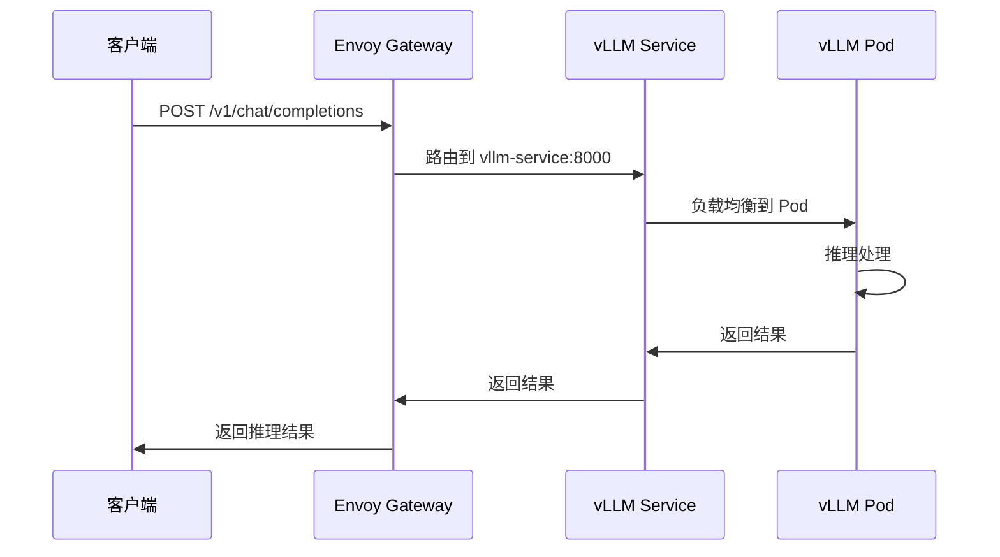

# AIBrix 推理集群部署

AIBrix 推理集群本地部署配置和文档。

---

## 部署状态 (2026-09-30)

### ✅ 已完成组件

| 组件 | 状态 | 版本/配置 | 说明 |
|------|------|----------|------|
| **Minikube** | ✅ Running | v1.39.0, K8s v1.28.0 | Docker driver, 单节点 |
| **NVIDIA Device Plugin** | ✅ Running | v0.20.0 | GPU: nvidia.com/gpu: 1 |
| **AIBrix Controller Manager** | ✅ Running | nightly (源码编译) | 9 个 CRD, --disable-webhook |
| **Redis** | ✅ Running | 7-alpine | aibrix-redis-master:6379 |
| **Gateway Plugins** | ✅ Running | nightly (源码编译) | gRPC :50052, HTTP :8080 |
| **Envoy Gateway** | ✅ Running | v1.33.2 | NodePort 30080, 静态配置 |
| **vLLM Pod** | ✅ 1/1 Running | Qwen3.5-4B | :8000, GPU 推理正常 |
| **Gateway API** | ✅ Installed | v1.2.1 | GatewayClass, Gateway, HTTPRoute |
| **端到端推理** | ✅ Working | OpenAI Compatible | 通过 AIBrix 网关成功推理 |

### 📊 集群资源

```bash
# Pods
NAMESPACE       NAME                                         READY   STATUS    RESTARTS   AGE
aibrix-system   aibrix-controller-manager-776d89fc84-qfcd5   1/1     Running   0          93m
aibrix-system   aibrix-envoy-6c675598c-6krf4                 1/1     Running   0          14s
aibrix-system   aibrix-gateway-plugins-78f94b94d-t4svp       1/1     Running   0          3m49s
aibrix-system   aibrix-redis-6f77445d5b-5h2f4                1/1     Running   0          107m
default         vllm-qwen35-4b-6c6fddf4d6-j682z              1/1     Running   0          89m

# Services
NAMESPACE       NAME                     TYPE        CLUSTER-IP       PORT(S)
aibrix-system   aibrix-envoy             NodePort    10.108.136.132   80:30080/TCP
aibrix-system   aibrix-gateway-plugins   ClusterIP   10.101.218.237   50052/TCP,6060/TCP,8080/TCP
aibrix-system   aibrix-redis-master      ClusterIP   10.107.84.59     6379/TCP
default         vllm-service             ClusterIP   10.111.106.125   8000/TCP

# Gateway API
NAMESPACE       NAME                                                    AGE
aibrix-system   gatewayclass.gateway.networking.k8s.io/aibrix-eg        2m46s
aibrix-system   gateway.gateway.networking.k8s.io/aibrix-eg             2m46s
aibrix-system   httproute.gateway.networking.k8s.io/qwen3.5-4b-router   2m3s
default         referencegrant.gateway.networking.k8s.io/allow-aibrix-to-vllm   107s
```

---

## 架构概览

### 集群拓扑图

```mermaid
graph TB
    subgraph "Client"
        Client[客户端请求]
    end

    subgraph "Minikube Cluster"
        subgraph "aibrix-system namespace"
            EG[Envoy Gateway<br/>NodePort: 30080]
            GP[Gateway Plugins<br/>gRPC: 50052<br/>HTTP: 8080]
            CM[Controller Manager<br/>9 CRDs]
            Redis[(Redis<br/>6379)]
        end
        
        subgraph "default namespace"
            vLLM[vLLM Pod<br/>Qwen3.5-4B<br/>:8000]
            VS[vLLM Service<br/>ClusterIP]
        end
    end

    Client -->|HTTP :30080| EG
    EG -->|路由请求| VS
    VS --> vLLM
    GP -->|管理路由| Redis
    CM -->|监控 Deployment| GP
    CM -->|创建 HTTPRoute| GP
    
    style EG fill:#e1f5ff
    style GP fill:#fff4e1
    style CM fill:#e8f5e9
    style vLLM fill:#fce4ec
    style Redis fill:#f3e5f5
```

### 请求流程



### 组件说明

| 组件 | 职责 |
|------|------|
| **Envoy Gateway** | 入口网关，接收外部请求，路由到后端服务 |
| **Gateway Plugins** | AIBrix 智能路由插件，提供负载均衡、前缀缓存等功能 |
| **Controller Manager** | Kubernetes 控制器，管理 ModelAdapter CRD，自动创建 HTTPRoute |
| **Redis** | 状态存储，用于缓存和协调 |
| **vLLM** | 模型推理引擎，提供 OpenAI 兼容 API |
| **Gateway API** | Kubernetes 标准网关 API，定义路由规则 |

---

## 使用方法

### 1. 访问 AIBrix 网关

```bash
# 获取 Minikube IP
MINIKUBE_IP=$(minikube ip)

# 列出模型
curl http://$MINIKUBE_IP:30080/v1/models

# 推理请求
curl http://$MINIKUBE_IP:30080/v1/chat/completions \
  -H "Content-Type: application/json" \
  -d '{
    "model": "qwen3.5-4b",
    "messages": [{"role": "user", "content": "你好"}],
    "max_tokens": 100
  }'
```

### 2. 直接访问 vLLM（绕过网关）

```bash
# 端口转发
kubectl port-forward svc/vllm-service 8000:8000 -n default &

# 推理请求
curl http://localhost:8000/v1/chat/completions \
  -H "Content-Type: application/json" \
  -d '{
    "model": "qwen3.5-4b",
    "messages": [{"role": "user", "content": "你好"}],
    "max_tokens": 100
  }'
```

---

## 部署文件

所有部署文件位于 `deploy/` 目录：

```
deploy/
├── manifests/
│   ├── controller-manager/     # AIBrix 控制器
│   ├── redis/                  # Redis 部署
│   ├── gateway-plugins/        # 网关插件
│   ├── envoy/                  # Envoy 网关配置
│   ├── vllm-deployment.yaml    # vLLM 部署
│   ├── gateway.yaml            # Gateway API 资源
│   ├── httproute-qwen35-4b.yaml # HTTPRoute 路由规则
│   └── referencegrant.yaml     # 跨命名空间引用授权
└── troubleshoot/               # 问题排查文档
```

---

## 技术细节

### 镜像构建

由于网络限制，所有镜像均从源码构建或使用国内镜像：

- **Controller Manager**: 从 AIBrix 源码编译
- **Gateway Plugins**: 从 AIBrix 源码编译（CGO_ENABLED=0 静态链接）
- **Envoy**: `docker.m.daocloud.io/envoyproxy/envoy:v1.33.2`
- **Redis**: `docker.m.daocloud.io/redis:7-alpine`

### Gateway API 配置

- **GatewayClass**: `aibrix-eg` (controller: gateway.envoyproxy.io/gatewayclass-controller)
- **Gateway**: `aibrix-eg` (HTTP :80)
- **HTTPRoute**: `qwen3.5-4b-router` (路由到 vllm-service)
- **ReferenceGrant**: 允许 aibrix-system 命名空间访问 default 命名空间的 vllm-service

### 关键标签

vLLM Deployment 必须包含以下标签才能被 AIBrix 识别：

```yaml
labels:
  model.aibrix.ai/name: qwen3.5-4b  # 模型名称
  model: qwen3.5-4b                  # 模型标识
  aibrix.io/model: qwen3.5-4b       # AIBrix 模型标签
```

---

## 已知问题

### 1. Gateway Plugins ExtProc 集成

当前 Envoy 使用静态配置直接路由到 vllm-service，未完全集成 Gateway Plugins 的 ExtProc 功能。原因：

- Envoy 使用 ORIGINAL_DST 集群需要 gateway-plugins 设置 `target-pod` 头部
- Gateway Plugins 设计用于与 Envoy Gateway（完整控制器）配合，使用 xDS 动态配置
- 当前简化配置绕过了 pod 级别的智能路由

**影响**: 基本的负载均衡和路由功能正常，但高级功能（如前缀缓存路由、会话亲和性）未完全启用。

### 2. ModelAdapter 命名问题

模型名称 `qwen3.5-4b` 包含点号（.），不符合 Kubernetes DNS-1035 规范，导致 ModelAdapter 控制器无法创建 Service。

**解决方案**: 使用 `qwen35-4b` 作为 Deployment 名称，但保留 `model.aibrix.ai/name: qwen3.5-4b` 标签。

---

## 后续优化

1. **完整 Envoy Gateway 集成**: 安装完整的 Envoy Gateway 控制器，启用 xDS 动态配置
2. **ExtProc 功能**: 启用 Gateway Plugins 的 ExtProc 集成，实现 pod 级别智能路由
3. **前缀缓存**: 配置前缀缓存路由，优化多轮对话性能
4. **多模型支持**: 部署多个模型，配置动态路由
5. **监控和指标**: 集成 Prometheus 和 Grafana，监控推理性能

---

## 参考文档

- [AIBrix 官方文档](https://aibrix.readthedocs.io/)
- [AIBrix GitHub](https://github.com/vllm-project/aibrix)
- [Gateway API 文档](https://gateway-api.sigs.k8s.io/)
- [Envoy 文档](https://www.envoyproxy.io/)

---

## 更新日志

### 2026-09-30
- ✅ 完成 AIBrix 控制平面部署
- ✅ 部署 vLLM 和 Qwen3.5-4B 模型
- ✅ 配置 Envoy 网关和 Gateway API
- ✅ 实现端到端推理功能
- ✅ 解决网络限制问题（使用国内镜像）
- ✅ 解决 Gateway API CRD 安装问题
- ✅ 解决 RBAC 权限问题

---

## 常用命令

### 查看集群状态

```bash
# 查看所有命名空间的 Pod
kubectl get pods -A

# 或完整写法
kubectl get pods --all-namespaces

# 查看所有命名空间的 Pod（更详细信息）
kubectl get pods -A -o wide

# 查看特定命名空间的 Pod
kubectl get pods -n aibrix-system
kubectl get pods -n default

# 查看所有服务
kubectl get svc -A

# 查看所有 Deployment
kubectl get deployments -A

# 查看 Gateway API 资源
kubectl get gatewayclass,gateway,httproute -A

# 查看集群节点
kubectl get nodes -o wide
```

### 查看日志

```bash
# 查看 Controller Manager 日志
kubectl logs -n aibrix-system deployment/aibrix-controller-manager --tail=100

# 查看 Gateway Plugins 日志
kubectl logs -n aibrix-system deployment/aibrix-gateway-plugins --tail=100

# 查看 Envoy 日志
kubectl logs -n aibrix-system deployment/aibrix-envoy --tail=100

# 查看 vLLM 日志
kubectl logs -n default deployment/vllm-qwen35-4b --tail=100
```

### 测试推理

```bash
# 获取 Minikube IP
MINIKUBE_IP=$(minikube ip)

# 列出模型
curl http://$MINIKUBE_IP:30080/v1/models

# 推理请求
curl http://$MINIKUBE_IP:30080/v1/chat/completions \
  -H "Content-Type: application/json" \
  -d '{
    "model": "qwen3.5-4b",
    "messages": [{"role": "user", "content": "你好"}],
    "max_tokens": 100
  }'
```
