# KV-Aware Routing 实现详解

## 目录

1. [概述](#概述)
   - [核心目标](#核心目标)
   - [与其他策略的对比](#与其他策略的对比)
2. [核心架构](#核心架构)
   - [整体架构](#整体架构)
   - [KV Router 内部架构](#kv-router-内部架构)
   - [部署模式对比](#部署模式对比)
   - [Kubernetes 部署拓扑](#kubernetes-部署拓扑)
   - [多数据中心部署](#多数据中心部署)
3. [关键组件](#关键组件)
   - [KV Cache Index (KV 缓存索引)](#1-kv-cache-index-kv-缓存索引)
     - [KV Cache Index 架构](#kv-cache-index-架构)
     - [PositionalIndexer 架构](#positionalindexer-架构)
     - [多层存储匹配流程](#多层存储匹配流程)
   - [Active Load Tracker (活跃负载跟踪器)](#2-active-load-tracker-活跃负载跟踪器)
     - [负载跟踪数据流](#负载跟踪数据流)
   - [Worker Selector (Worker 选择器)](#3-worker-selector-worker-选择器)
   - [Local Scheduler (本地调度器)](#4-local-scheduler-本地调度器)
     - [Worker 状态转换](#worker-状态转换)
4. [工作流程](#工作流程)
   - [数据流架构](#数据流架构)
   - [请求处理完整流程](#请求处理完整流程)
   - [请求生命周期](#请求生命周期)
   - [请求数据流](#请求数据流)
   - [请求接收和预处理](#1-请求接收和预处理)
   - [重叠度计算](#2-重叠度计算)
   - [Worker 过滤](#3-worker-过滤)
   - [成本计算](#4-成本计算)
     - [Worker 选择决策流程](#worker-选择决策流程)
   - [Worker 选择](#5-worker-选择)
   - [负载更新](#6-负载更新)
     - [KV Cache 事件处理流程](#kv-cache-事件处理流程)
     - [KV Cache 事件数据流](#kv-cache-事件数据流)
5. [成本计算模型](#成本计算模型)
   - [成本计算详细流程](#成本计算详细流程)
   - [核心公式](#核心公式)
   - [各项详解](#各项详解)
   - [成本示例](#成本示例)
   - [缓存命中率影响](#缓存命中率影响)
6. [数据结构和索引](#数据结构和索引)
   - [索引器性能对比](#索引器性能对比)
   - [Block Hash 标识符](#block-hash-标识符)
   - [索引器选择指南](#索引器选择指南)
   - [性能指标](#性能指标)
7. [配置和调优](#配置和调优)
   - [配置优先级](#配置优先级)
   - [启用 KV-Aware Routing](#启用-kv-aware-routing)
     - [路由模式配置](#路由模式配置)
   - [关键配置参数](#关键配置参数)
   - [调优建议](#调优建议)
   - [Worker 配置一致性](#worker-配置一致性)
   - [监控和调试](#监控和调试)
8. [总结](#总结)

---

## 概述

KV-Aware Routing 是 Dynamo 的核心路由机制,通过结合 **可复用的 KV Cache 状态** 和 **预测的活跃负载**,选择能够以最低预测成本处理请求的 worker。

### 核心目标

- **减少重复计算**: 优先选择已缓存请求前缀的 worker,避免重复计算 prompt 的 attention 状态
- **负载均衡**: 避免仅基于缓存亲和性导致热点 worker 过载
- **最优化成本**: 综合考虑 prefill 计算成本、decode 成本和活跃请求成本

### 与其他策略的对比

| 路由策略 | 考虑因素 | 适用场景 |
|---------|---------|---------|
| Round-Robin | 无 | 简单轮询,不考虑状态 |
| Random | 无 | 随机选择 |
| Least-Loaded | 活跃连接数 | 基于负载的简单路由 |
| **KV-Aware** | **KV Cache 重叠 + 活跃负载** | **LLM 推理优化** |

---

## 核心架构

```
┌─────────────────────────────────────────────────────────────┐
│                      Client Request                         │
└──────────────────────┬──────────────────────────────────────┘
                       │
                       ▼
        ┌──────────────────────────────┐
        │  Dynamo Frontend / EPP       │
        │  (Request Path Host)         │
        └──────────┬───────────────────┘
                   │
                   ├─► Tokenize & Normalize
                   │
                   ▼
        ┌──────────────────────────────┐
        │      KV Router               │
        │  ┌────────────────────────┐  │
        │  │  KV Cache Index        │◄─┼── Worker KV Events
        │  │  (Prefix Overlap)      │  │   (Cache State)
        │  └────────────────────────┘  │
        │                              │
        │  ┌────────────────────────┐  │
        │  │  Active Load Tracker   │◄─┼── Worker Load Updates
        │  │  (Projected Load)      │  │   (Active Requests)
        │  └────────────────────────┘  │
        │                              │
        │  ┌────────────────────────┐  │
        │  │  Worker Selector       │  │
        │  │  (Cost Calculation)    │  │
        │  └────────────────────────┘  │
        └──────────┬───────────────────┘
                   │
                   ▼
        ┌──────────────────────────────┐
        │     Selected Worker          │
        │  (Lowest Cost Candidate)     │
        └──────────────────────────────┘
```

---


### 整体架构

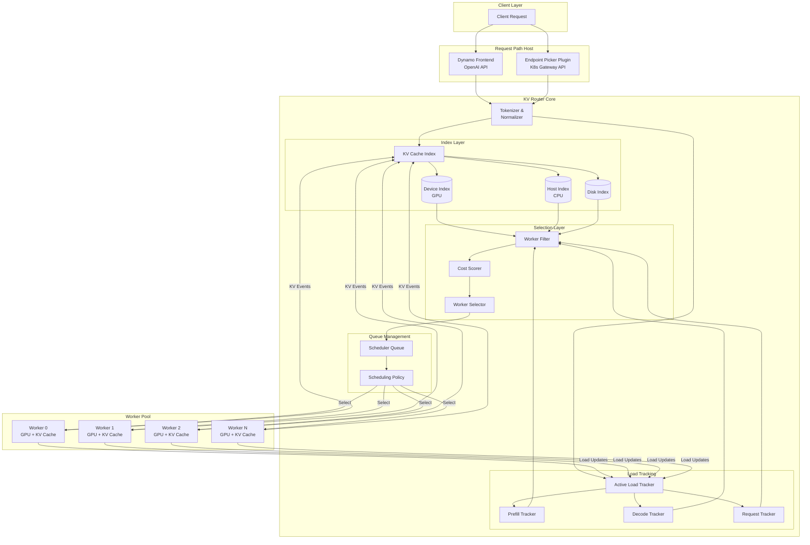


### KV Router 内部架构

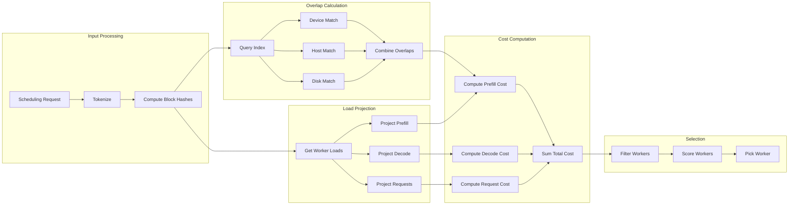


### 部署模式对比

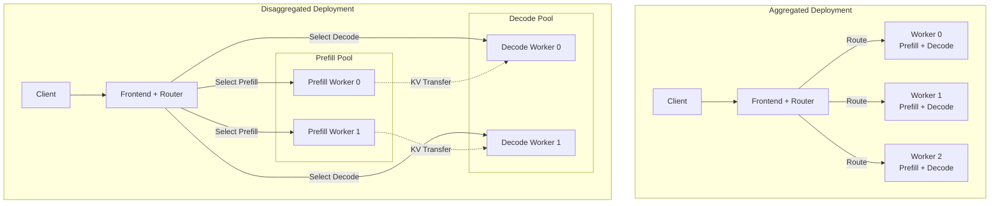


### Kubernetes 部署拓扑

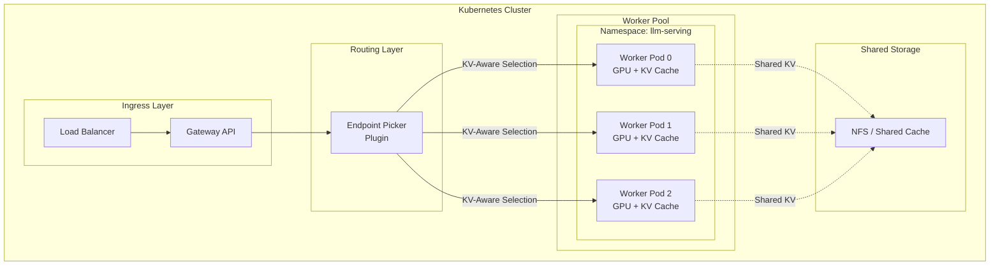


### 多数据中心部署

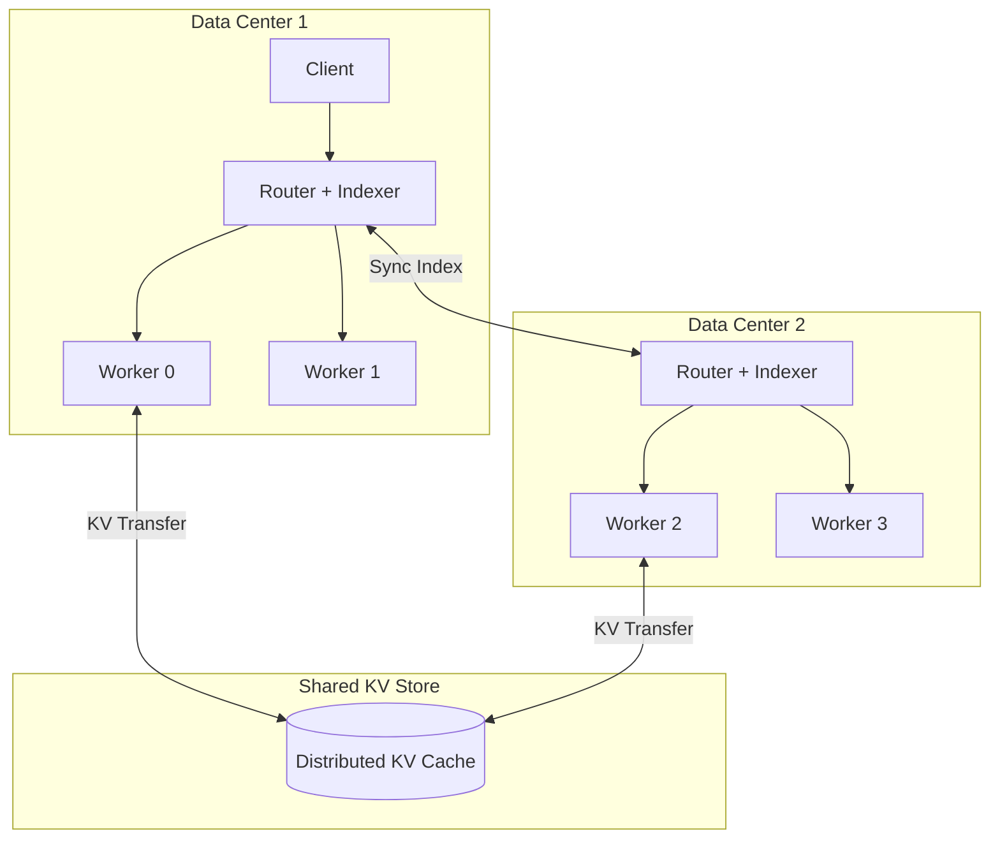

## 关键组件

### 1. KV Cache Index (KV 缓存索引)

**位置**: `lib/kv-router/src/indexer/`

**核心职责**:
- 跟踪每个 worker 缓存的 KV blocks
- 计算请求与 worker 缓存的前缀重叠度
- 支持多层存储 (Device, Host-Pinned, Disk, External)

**主要实现**:

#### RadixTree (单线程压缩树)
```rust
RadixTree
├── root: SharedRadixBlock (Rc<RefCell<RadixBlock>>)
└── lookup: HashMap<Worker, HashMap<SeqHash, SharedRadixBlock>>

RadixBlock
├── state.edge: Vec<(LocalBlockHash, SeqHash)>
├── state.edge_index: HashMap<SeqHash, Position>
├── state.worker_cutoffs: HashMap<Worker, Position>
├── children: HashMap<LocalBlockHash, SharedRadixBlock>
├── parent: Weak<RefCell<RadixBlock>>
└── internal: bool
```

**操作**:
- `store_blocks(worker, parent_hash, blocks)`: 添加 worker 的缓存块
- `remove_blocks(worker, block_hashes)`: 移除 worker 的缓存块
- `find_matches(local_hashes, early_exit)`: 查找具有匹配前缀的 worker

**复杂度**:
- 存储/删除: O(N)
- 查找匹配: O(D × W),D = 深度,W = worker 数量

#### ConcurrentRadixTreeCompressed (并发压缩树)
```
                   ┌──────────────────────────────┐
find_matches() ──→ │ Arc<ConcurrentRadixTree>     │ ◄── 读取并发
                   │                              │
 KV events ──→ flume[0] ──→ thread 0 (W0, W3) ──→ │
           ──→ flume[1] ──→ thread 1 (W1, W4) ──→ │ ◄── 写入串行化
           ──→ flume[2] ──→ thread 2 (W2, W5) ──→ │   (sticky routing)
                   └──────────────────────────────┘
```

**特点**:
- 线程安全的压缩边(trie)节点
- ThreadPoolIndexer 包装,实现 per-worker sticky routing
- 读取并发,写入通过 flume channel 串行化

#### PositionalIndexer (嵌套 Map)
```rust
PositionalIndexer
├── index: DashMap<(Position, LocalHash), SeqEntry>
├── worker_blocks: DashMap<Worker, RwLock<HashMap<SeqHash, (Position, LocalHash)>>>
└── jump_size: usize

SeqEntry (enum)
├── Single(SeqHash, HashSet<Worker>)  // 常见:一个 seq_hash
└── Multi(HashMap<SeqHash, HashSet<Worker>>)  // 罕见:多个前缀
```

**优化**:
- **Jump Optimization**: 跳过 jump_size 位置(如 32),O(1) 随机访问
- **Lazy Hash Optimization**: 大多数 (position, local_hash) 只有一个 seq_hash,跳过计算

**复杂度**:
- 查找匹配: O(D/J),J = jump_size


### KV Cache Index 架构

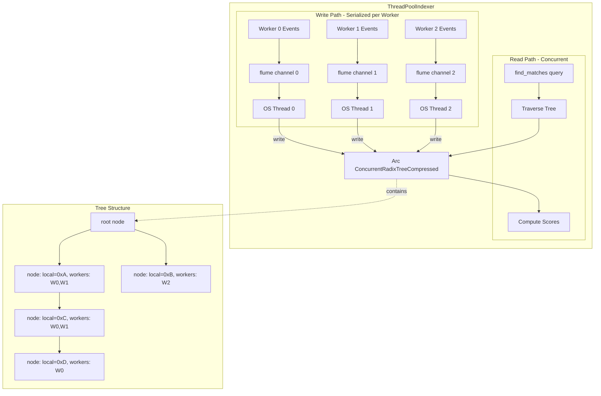


### PositionalIndexer 架构

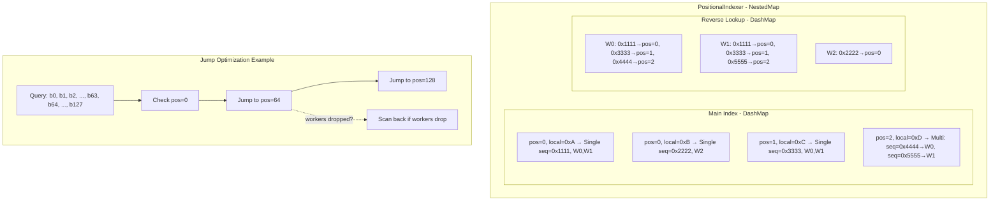


### 多层存储匹配流程

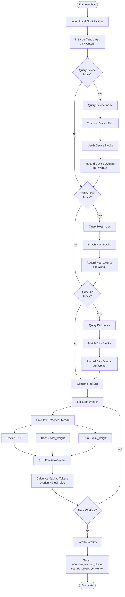

### 2. Active Load Tracker (活跃负载跟踪器)

**位置**: `lib/kv-router/src/sequences/`

**核心职责**:
- 跟踪每个 worker 的活跃 prefill tokens
- 跟踪每个 worker 的活跃 decode blocks
- 跟踪每个 worker 的活跃请求数
- 预测新请求的负载影响

**数据结构**:
```rust
WorkerLoadProjection {
    active_prefill_tokens: usize,
    active_decode_blocks: usize,
    active_requests: usize,
}
```

**负载建模**:

#### Prefill Load Modeling
- **默认**: 有效 prefill 负载(未缓存的 prompt tokens)保持全值,直到第一个输出 token
- **AIS 模式** (`--router-prefill-load-model ais`): 使用 AISimulate 预测 prefill 持续时间,基于时间衰减

#### Decode Load Modeling
- 跟踪活跃 KV blocks 和活跃请求数
- 可选启用 `--router-track-output-blocks`: 随生成进度添加占位输出 blocks
- 可选启用 `--router-decode-active-request-weight`: 为每个活跃请求添加 block 等效成本


### 负载跟踪数据流

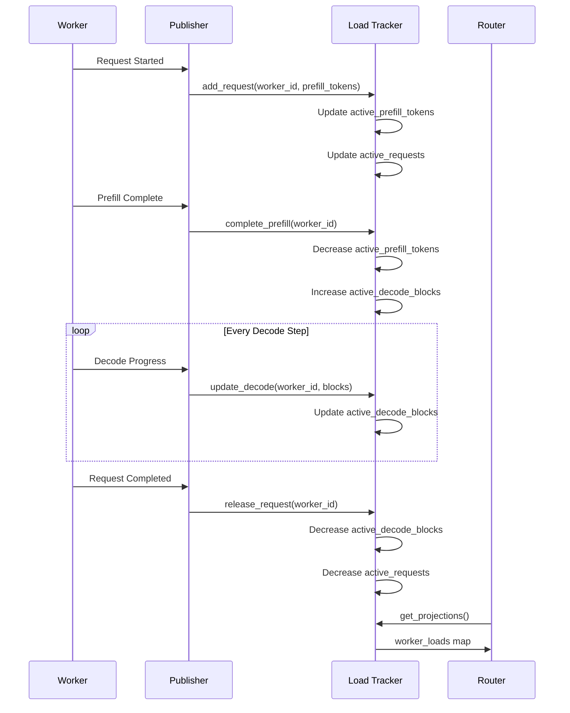

### 3. Worker Selector (Worker 选择器)

**位置**: `lib/kv-router/src/scheduling/selector/`

**核心职责**:
- 实现成本计算逻辑
- 过滤不合格的 worker
- 选择成本最低的 worker

**主要 trait**:
```rust
pub trait WorkerSelector<C: WorkerConfigLike> {
    fn required_worker_inputs(&self) -> WorkerInputs;
    
    fn select_worker(
        &self,
        input: WorkerSelectionInput<'_, C>,
    ) -> Result<WorkerSelectionResult, KvSchedulerError>;
}
```

**输入**:
```rust
WorkerSelectionInput<'a, C> {
    workers: &'a HashMap<WorkerId, C>,
    request: &'a SchedulingRequest,
    eligibility: RoutingEligibility<'a>,
    block_size: u32,
}
```

### 4. Local Scheduler (本地调度器)

**位置**: `lib/kv-router/src/scheduling/local.rs`

**核心职责**:
- 协调 KV Cache Index、Active Load Tracker 和 Worker Selector
- 管理请求队列和调度策略
- 处理 worker 配置更新和拓扑变化

**主要结构**:
```rust
pub struct LocalScheduler<P, C, Sel, RF> {
    slots: Arc<ActiveSequencesMultiWorker<P>>,
    queue: Arc<SchedulerQueue<P, C, Sel, RF>>,
    queue_updates: watch::Sender<()>,
    worker_configs: watch::Receiver<HashMap<WorkerId, C>>,
    // ...
}
```

---


### Worker 状态转换

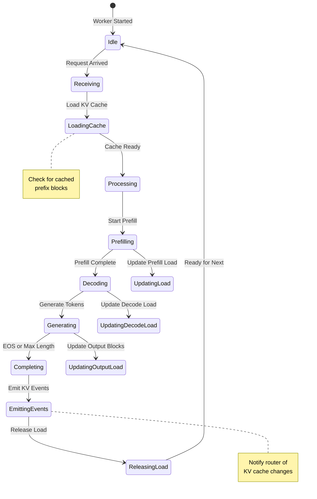

## 工作流程


### 数据流架构

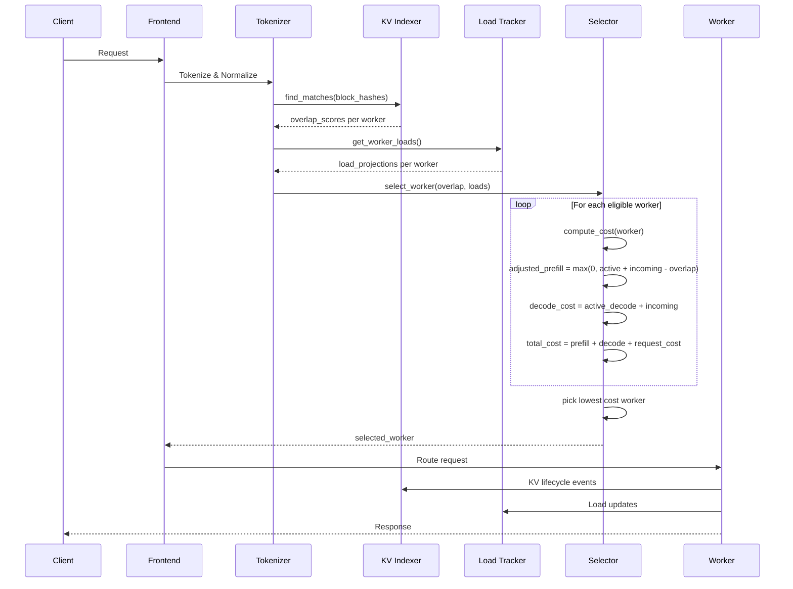


### 请求处理完整流程

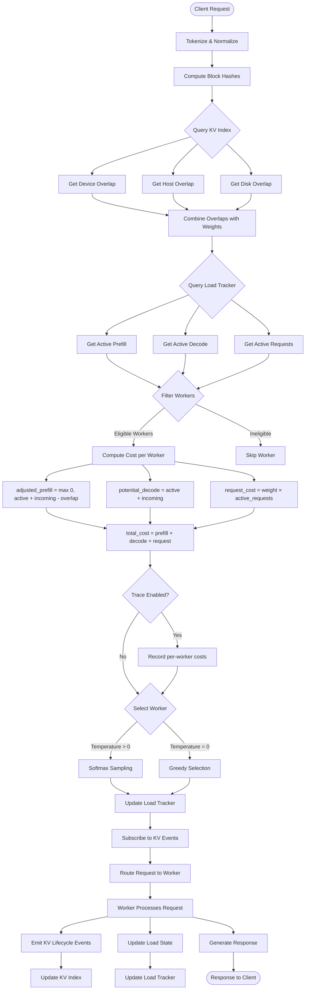


### 请求生命周期

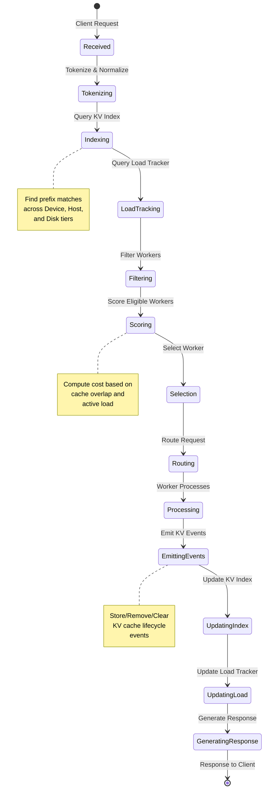


### 请求数据流

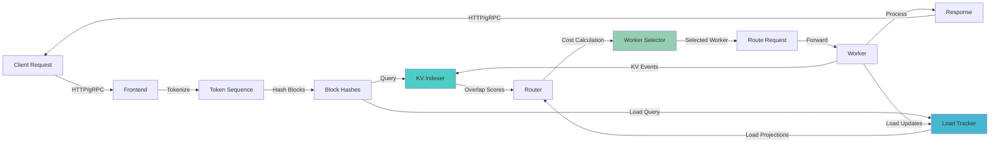


### 1. 请求接收和预处理

```rust
// 1. Tokenize and normalize
let token_seq = tokenize_and_normalize(request.prompt);
let block_hashes = compute_block_hashes(&token_seq, block_size);

// 2. Query KV Cache Index for overlap
let overlap_scores = kv_indexer.find_matches(&block_hashes);
let tier_overlap_blocks = compute_tier_overlap(&overlap_scores);

// 3. Query Active Load Tracker
let worker_loads = active_load_tracker.get_projections();
```

### 2. 重叠度计算

**位置**: `lib/kv-router/src/scheduling/overlap.rs`

```rust
// 计算多层存储的有效重叠
effective_overlap_blocks = device_overlap_blocks
    + host_pinned_overlap_blocks * host_cache_hit_weight
    + disk_overlap_blocks * disk_cache_hit_weight;

// 转换为缓存 tokens
cached_tokens = effective_overlap_blocks * block_size;
```

**多层存储权重**:
- Device (GPU): 1.0
- Host-Pinned (CPU): `config.host_cache_hit_weight` (默认 0.5)
- Disk/External: `config.disk_cache_hit_weight` (默认 0.3)


### 3. Worker 过滤

**位置**: `lib/kv-router/src/scheduling/filter.rs`

**过滤条件**:
- Request allow-lists (允许的 worker 列表)
- Exact pins (精确绑定)
- DP-rank bounds (数据并行 rank 边界)
- Required taints (必需的 taints)
- Busy-threshold overload state (忙碌阈值过载状态)

### 4. 成本计算

**位置**: `lib/kv-router/src/scheduling/selector/policy.rs`

详见下一节 [成本计算模型](#成本计算模型)。


### Worker 选择决策流程

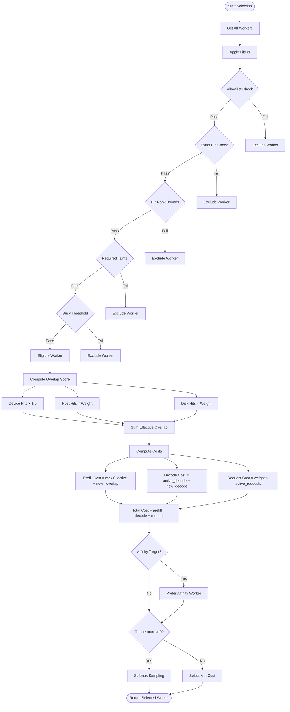

### 5. Worker 选择

```rust
// 1. 计算所有合格 worker 的成本
let candidates: Vec<CandidateData> = eligible_workers
    .iter()
    .map(|worker| compute_candidate_data(worker, request))
    .collect();

// 2. 应用 worker selection policy
let scored_candidates = policy.score_candidates(&candidates);

// 3. 选择成本最低的 worker
let selected_worker = if router_temperature > 0 {
    // Softmax sampling with temperature
    softmax_sample(&scored_candidates, router_temperature)
} else {
    // Greedy selection
    scored_candidates.iter().min_by_key(|c| c.cost).worker
};
```

### 6. 负载更新

```rust
// 1. 更新 Active Load Tracker
active_load_tracker.add_request(
    selected_worker,
    request_id,
    prompt_tokens,
    expected_output_tokens,
);

// 2. 订阅 worker 的 KV lifecycle events
kv_indexer.subscribe_worker_events(selected_worker);

// 3. 当请求完成时释放负载
active_load_tracker.release_request(selected_worker, request_id);
```

---


### KV Cache 事件处理流程

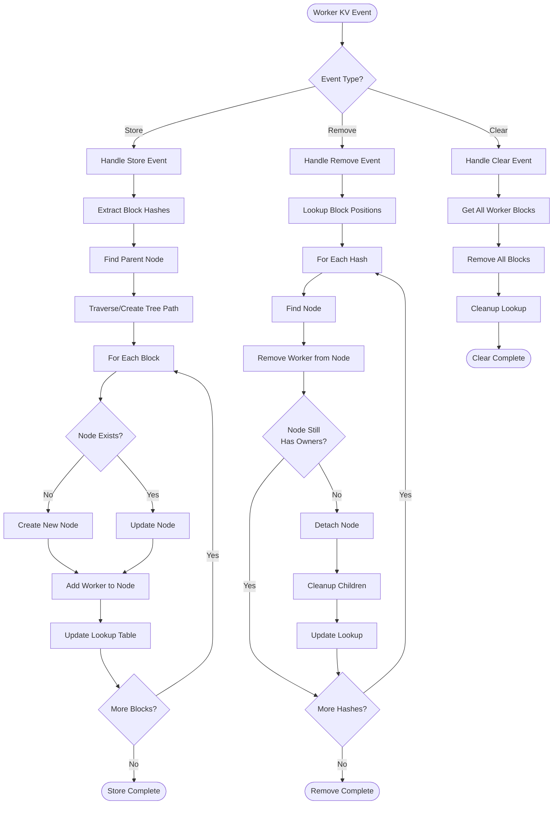


### KV Cache 事件数据流

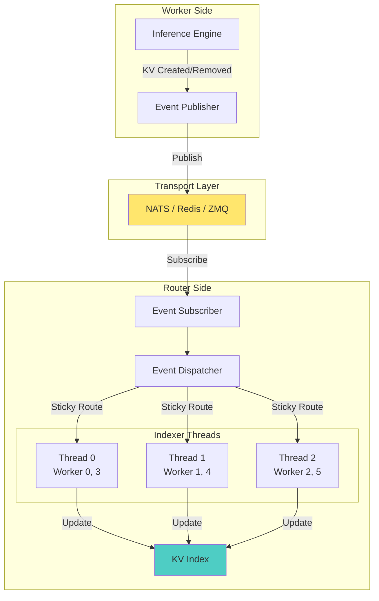

## 成本计算模型


### 成本计算详细流程

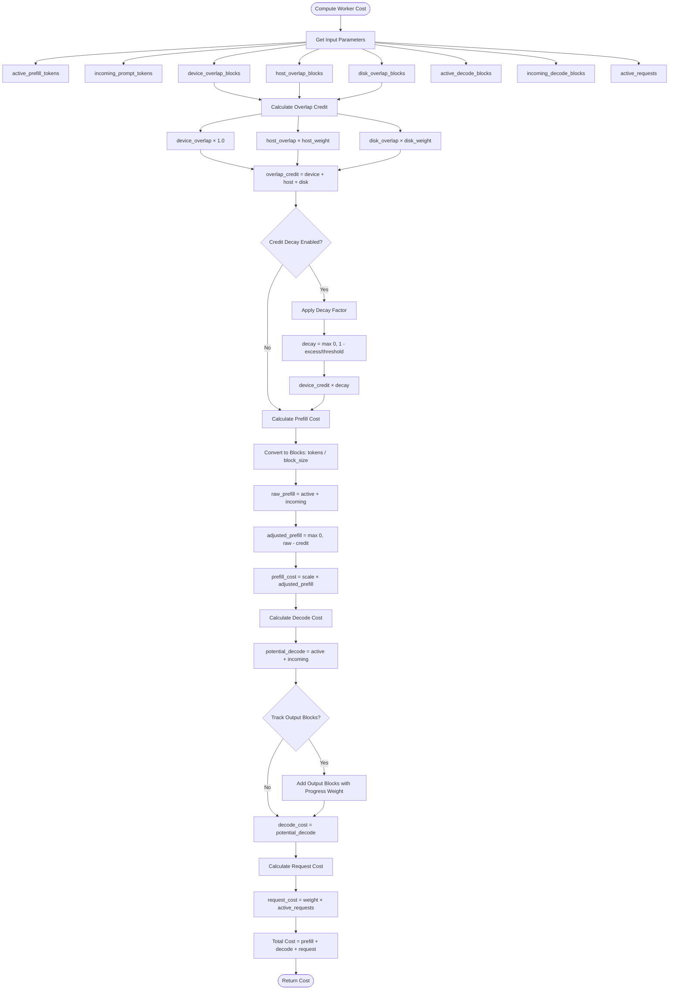

### 核心公式

```
raw_prefill_blocks = active_prefill_blocks + incoming_prompt_blocks
adjusted_prefill_blocks = max(0, raw_prefill_blocks - overlap_credit_blocks)
potential_decode_blocks = active_decode_blocks + incoming_active_blocks
active_request_blocks = decode_active_request_weight * active_requests

cost = prefill_load_scale * adjusted_prefill_blocks 
     + potential_decode_blocks 
     + active_request_blocks
```

### 各项详解

#### 1. Prefill Cost (Prefill 成本)

```
adjusted_prefill_blocks = max(0, 
    active_prefill_tokens / block_size 
    + incoming_prompt_tokens / block_size 
    - overlap_credit_blocks
)
```

**组成部分**:
- `active_prefill_blocks`: worker 当前正在处理的 prefill tokens(以 block 为单位)
- `incoming_prompt_blocks`: 新请求的 prompt tokens(以 block 为单位)
- `overlap_credit_blocks`: 缓存重叠信用(减少的成本)

**Overlap Credit 计算**:
```
overlap_credit_blocks = device_overlap_blocks
    + host_pinned_overlap_blocks * host_cache_hit_weight
    + disk_overlap_blocks * disk_cache_hit_weight
    + shared_cache_overlap_blocks * shared_cache_weight
```

**Device Overlap Decay**:
```
if overlap_score_credit_decay > 0:
    decay_factor = max(0, 1 - excess_prefill_load / decay_threshold)
    device_overlap_credit *= decay_factor
```

#### 2. Decode Cost (Decode 成本)

```
potential_decode_blocks = active_decode_blocks + incoming_active_blocks
```

**组成部分**:
- `active_decode_blocks`: worker 当前活跃的 decode KV blocks
- `incoming_active_blocks`: 新请求预计使用的 decode blocks

**可选增强**:
- `--router-track-output-blocks`: 跟踪输出 blocks,随生成进度增加
- Expected OSL (Output Sequence Length): 基于预期输出长度的分数权重

#### 3. Active Request Cost (活跃请求成本)

```
active_request_blocks = decode_active_request_weight * active_requests
```

**说明**:
- `decode_active_request_weight`: 默认为 0(可选)
- 启用后,每个活跃请求添加 block 等效成本
- 适用于 decode 延迟对 batch size 敏感的场景

### 成本示例

**场景 1: Worker A (缓存热)**
```
active_prefill_blocks = 10
incoming_prompt_blocks = 20
device_overlap_blocks = 15 (75% 缓存命中)
host_cache_hit_weight = 0.5
overlap_credit_blocks = 15 * 1.0 = 15

adjusted_prefill_blocks = max(0, 10 + 20 - 15) = 15
active_decode_blocks = 5
incoming_active_blocks = 2
potential_decode_blocks = 5 + 2 = 7
active_requests = 3
decode_active_request_weight = 0 (默认)

cost = 1.0 * 15 + 7 + 0 = 22
```

**场景 2: Worker B (缓存冷)**
```
active_prefill_blocks = 5
incoming_prompt_blocks = 20
device_overlap_blocks = 0 (无缓存命中)
overlap_credit_blocks = 0

adjusted_prefill_blocks = max(0, 5 + 20 - 0) = 25
active_decode_blocks = 3
incoming_active_blocks = 2
potential_decode_blocks = 3 + 2 = 5
active_requests = 2

cost = 1.0 * 25 + 5 + 0 = 30
```

**结果**: 选择 Worker A (成本 22 < 30),即使它的活跃负载更高,因为缓存命中显著降低了 prefill 成本。

---


### 缓存命中率影响

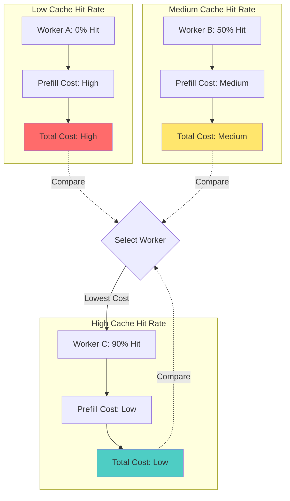

## 数据结构和索引


### 索引器性能对比

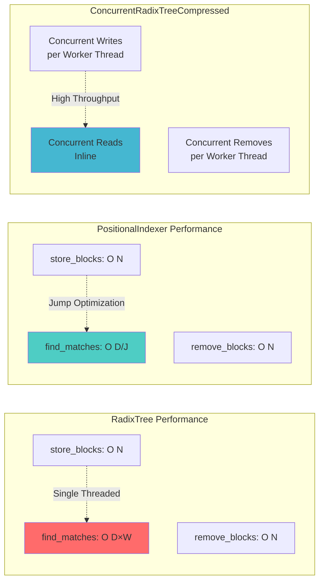

### Block Hash 标识符

#### 1. LocalBlockHash (u64)
```
Block at position 5: tokens [101, 102, 103, ...]
LocalBlockHash = hash(tokens) = 0xABCD1234
```
**用途**: 标识单个 block 的内容,独立于上下文

#### 2. ExternalSequenceBlockHash (u64)
```
Sequence A: [block0, block1, block2]
block2 in A: seq_hash = hash(hash(hash(block0) || block1) || block2) = 0x1111
```
**用途**: 唯一标识 block 在特定序列历史中的位置

**计算**: `seq_hash[i] = hash(seq_hash[i-1] || local_hash[i])`

#### 3. WorkerWithDpRank
```rust
WorkerWithDpRank {
    worker_id: WorkerId,
    dp_rank: DpRank,
}
```
**用途**: 标识哪个 worker(及其数据并行 rank)缓存了该 block

### 索引器选择指南

```
Start
  │
  ├─ Single worker or worker-side local index?
  │      └─ RadixTree (非并发)
  │
  ├─ < ~1000 workers, no sharding needed?
  │      └─ ThreadPoolIndexer<ConcurrentRadixTreeCompressed>
  │
  └─ ≥ ~1000 workers or need one-shard lookups?
         │
         ├─ Need approximate pruning?
         │      └─ ThreadPoolIndexer<CRTC>
         │
         └─ Need routing-correct sharding?
                └─ BranchShardedIndexer<CRTC>
```

### 性能指标

**吞吐量**:
- 组合吞吐量: **> 10 million events + requests per second**
- p99 延迟: **< 10 microseconds**

**内存开销**:
- RadixTree: 较高 (Rc/Arc overhead per node)
- PositionalIndexer: 较低 (flat entries)
- ConcurrentRadixTreeCompressed: 中等 (Arc nodes + compressed edges)

---

## 配置和调优


### 配置优先级

```mermaid
graph TB
    subgraph "Configuration Hierarchy"
        Default[Default Values<br/>Lowest Priority]
        Frontend[Frontend Config<br/>--router-mode kv]
        WorkerSet[Worker Set Config<br/>Model Deployment Card]
        Request[Request Override<br/>router_config_override]
    end
    
    Default -->|Override| Frontend
    Frontend -->|Override| WorkerSet
    WorkerSet -->|Override| Request
    
    Request --> Final[Final Configuration<br/>Highest Priority]
    
    style Default fill:#e0e0e0
    style Frontend fill:#b0b0b0
    style WorkerSet fill:#808080
    style Request fill:#4ecdc4
    style Final fill:#96ceb4
```

### 启用 KV-Aware Routing

```bash
# 基本启用
python -m dynamo.frontend --router-mode kv

# 禁用 KV events (仅基于负载)
python -m dynamo.frontend --router-mode kv --no-router-kv-events
```


### 路由模式配置

```mermaid
graph TD
    RouterMode{--router-mode}
    
    RouterMode -->|kv| KV[KV-Aware Routing]
    RouterMode -->|round-robin| RR[Round Robin]
    RouterMode -->|random| Random[Random]
    RouterMode -->|power-of-two| POT[Power of Two]
    RouterMode -->|least-loaded| LL[Least Loaded]
    RouterMode -->|device-aware-weighted| DAW[Device Aware Weighted]
    RouterMode -->|direct| Direct[Direct Routing]
    
    KV --> KVConfig[Requires:<br/>KV Events<br/>Load Tracking]
    KV --> KVFeatures[Features:<br/>Cache Locality<br/>Load Balance]
    
    RR --> RRConfig[Simple:<br/>No State]
    RR --> RRFeatures[Use Case:<br/>Baseline Testing]
    
    LL --> LLConfig[Requires:<br/>Load Tracking]
    LL --> LLFeatures[Use Case:<br/>General Load Balance]
    
    style KV fill:#4ecdc4
    style KVConfig fill:#ffe66d
    style KVFeatures fill:#96ceb4
```

### 关键配置参数

#### 路由模式
```bash
--router-mode kv                    # KV-aware routing
--router-mode round-robin           # 轮询
--router-mode random                # 随机
--router-mode power-of-two          # 两次选择
--router-mode least-loaded          # 最少负载
--router-mode device-aware-weighted # 设备感知加权
```

#### Prefill Load Model
```bash
--router-prefill-load-model default  # 静态计数直到第一个输出 token
--router-prefill-load-model ais      # AISimulate 时间衰减模型
```

#### Decode Load Tracking
```bash
--router-track-output-blocks              # 跟踪输出 blocks
--router-decode-active-request-weight 0.5 # 每个活跃请求的 block 等效成本
```

#### Cache Hit Weights
```bash
--host-cache-hit-weight 0.5    # Host-pinned 缓存权重
--disk-cache-hit-weight 0.3    # Disk 缓存权重
--shared-cache-weight 0.8      # Shared cache 权重
```

#### Router Temperature
```bash
--router-temperature 0.0  # Greedy selection (默认)
--router-temperature 0.5  # Softmax sampling with temperature
```

### 调优建议

#### 场景 1: 高缓存命中率
```bash
# 增加缓存重叠的权重
--host-cache-hit-weight 0.7
--disk-cache-hit-weight 0.5
--overlap-score-credit-decay 0.0  # 禁用衰减
```

#### 场景 2: 负载均衡优先
```bash
# 减少缓存影响,增加负载影响
--host-cache-hit-weight 0.3
--disk-cache-hit-weight 0.2
--router-decode-active-request-weight 1.0
--prefill-load-scale 1.5
```

#### 场景 3: 大规模集群 (>1000 workers)
```bash
# 使用分支分片索引器
--indexer-type branch-sharded
--branch-shard-count 16
```

#### 场景 4: 低延迟优先
```bash
# 禁用高级负载建模
--router-prefill-load-model default
--no-router-track-output-blocks
--router-temperature 0.0
```

### Worker 配置一致性

**Worker Set 定义**:
- 相同 namespace, component, endpoint, model, worker type
- 第一个有效的 model deployment card 保留配置
- 不同 MDC checksum 的 replica 不接收流量

**配置替换规则**:
- Worker set 配置**替换**(而非合并)Frontend 配置
- 省略的设置使用默认值,而非继承 Frontend 值

### 监控和调试

#### 启用 Selection Trace
```bash
--selection-trace-enabled
--selection-trace-output /tmp/routing-trace.json
```

#### Prometheus Metrics
```
# KV Indexer 指标
kv_indexer_find_matches_duration_seconds
kv_indexer_store_blocks_duration_seconds
kv_indexer_remove_blocks_duration_seconds

# Router 指标
router_selection_cost_total
router_selection_cache_overlap_blocks
router_selection_active_load_blocks

# Worker 指标
worker_active_prefill_tokens
worker_active_decode_blocks
worker_active_requests
```

---


## 总结

KV-Aware Routing 通过以下机制实现高效的 LLM 推理路由:

1. **多层 KV Cache 索引**: 跟踪 Device、Host-Pinned、Disk 和 External 存储的缓存状态
2. **活跃负载建模**: 实时跟踪和预测 prefill、decode 和活跃请求负载
3. **综合成本计算**: 结合缓存重叠和活跃负载,选择成本最低的 worker
4. **灵活的配置**: 支持多种路由模式、负载模型和调优参数
5. **高性能实现**: 使用并发数据结构和优化算法,实现 >10M ops/sec 和 <10μs p99 延迟

通过合理使用 KV-Aware Routing,可以显著减少重复计算,提高系统吞吐量,同时保持负载均衡。
